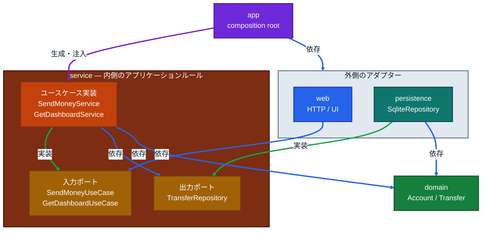
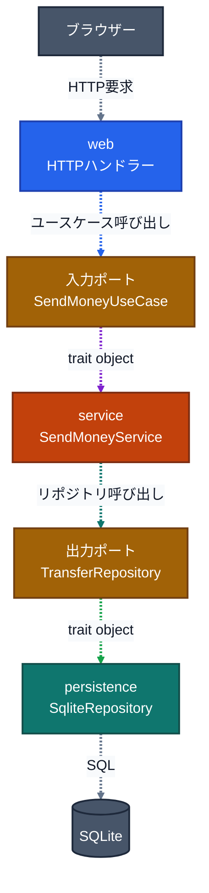

# アーキテクチャ

## クレートと依存方向

この図の**実線**はソースコード上の関係を示します。青は依存、紫は`app`による生成・注入、緑はポートの実装です。外側の`persistence`が内側のserviceで定義された`TransferRepository`を実装し、`web`はserviceの入力ポートに依存します。

### 実行時の呼び出し

この図の**点線**は実行時の呼び出しです。グレーは外部との通信、青はユースケース呼び出し、紫はtrait object経由のディスパッチ、青緑はリポジトリ呼び出し、緑は永続化処理を示します。serviceがポートを呼び、注入済みのSQLite実装が応答します。`app`は`Arc<dyn TransferRepository>`とユースケースtrait objectを組み立ててWebへ注入します。`domain`は他の自プロジェクトクレートに依存せず、serviceにもHTTP・SQLx・SQLiteの型を持ち込みません。

## ポートの具体例

送金とダッシュボード取得で、serviceはデータ保存を必要としますが、SQLiteの具体型には依存しません。[`TransferRepository`](../crates/service/src/ports/repository.rs) が必要な操作を定義し、`persistence`の`SqliteRepository`が実装します。永続化の詳細がservice所有の抽象に合わせます。

同様に、serviceは [`SendMoneyUseCase`](../crates/service/src/transfer/send_money.rs) と `GetDashboardUseCase` を入力ポートとして定義します。`web`はこれらのtraitを呼び出し、具象ユースケースを参照しません。serviceはSQLite・SQLx・HTTPを知りません。

実行時にはserviceが`TransferRepository`を呼びますが、実装の選択と注入は [`app/src/main.rs`](../app/src/main.rs) で行います。ここで`SqliteRepository`を`Arc<dyn TransferRepository>`としてユースケースへ渡し、`SendMoneyService`／`GetDashboardService`をWebへ渡します。ユースケーステストでは、この実装をfakeに差し替えられます。

## 境界と責務

- `service`は同一口座や送金上限などのユースケース上の検証を行います。送金先・送金元の残高ルールは`domain`のモデルで判断し、SQLite実装は書き込みロック中に残高を読み、検証・記録を同一トランザクションで行います。
- `persistence`はSQLxの失敗をログに記録して`TransferRepositoryError`へ変換します。serviceはそれをユースケースのエラーへ変換し、webは業務結果や抽象化された失敗をHTTP応答へ変換します。SQLite固有のエラー型は外側に留まります。
- `web`は`SendMoneyUseCase`／`GetDashboardUseCase`とserviceのDTOを使い、画面表示前にWeb所有のViewModelへ変換します。SQLx行型やSQLite接続型を扱いません。
- 設定の読込、DB接続・マイグレーション、依存の組み立ては`app`が担います。画面文言は`web`、DBスキーマは`migrations/`が所有します。

## テスト

ユースケースはfakeリポジトリでSQLiteなしにテストし、永続化はインメモリSQLiteと実マイグレーションで検証します。全テストは`cargo test --workspace`で実行します。
