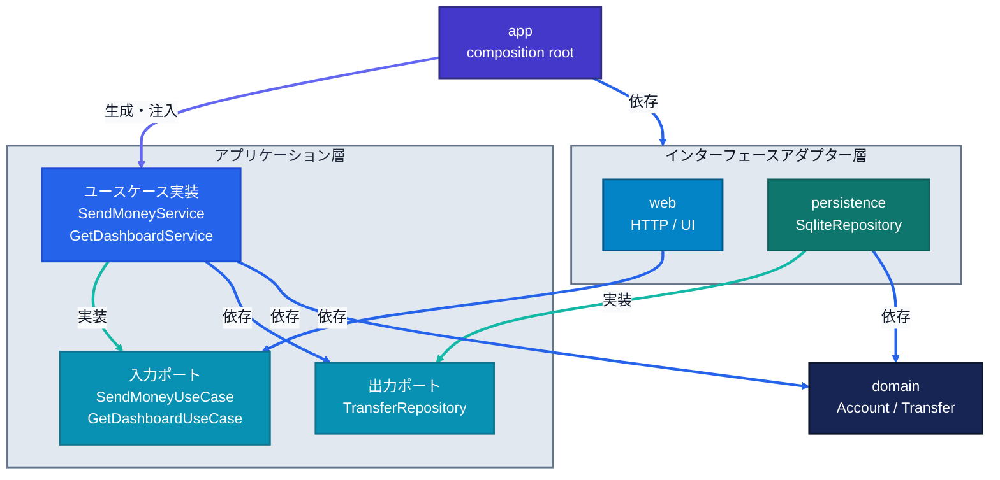
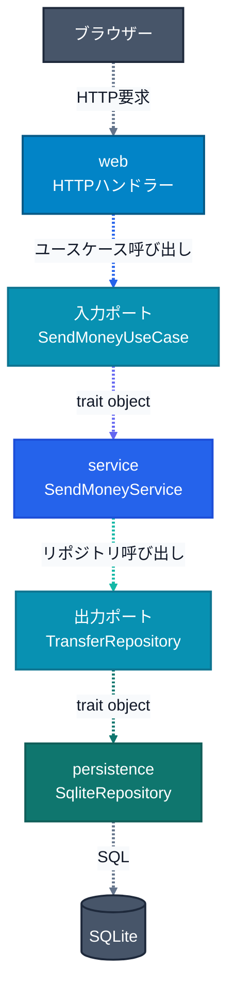

# アーキテクチャ

## クレートと依存方向

この図の実線はソースコード上の関係です。青はクレート依存、インディゴは`app`による生成・注入、シアンはポートの実装を示します。外側の`persistence`が内側のserviceで定義された`TransferRepository`を実装し、`web`はserviceの入力ポートに依存します。

### 実行時の呼び出し

この図の点線は実行時の呼び出しです。スレートは外部との通信、青はユースケース呼び出し、インディゴはtrait object経由のディスパッチ、シアンはリポジトリ呼び出し、濃いシアンは永続化処理を示します。serviceがポートを呼び、注入済みのSQLite実装が応答します。`app`は`Arc<dyn TransferRepository>`とユースケースtrait objectを組み立ててWebへ注入します。

## 依存性逆転

serviceはデータ保存を必要としますが、SQLiteの具体型には依存しません。[`TransferRepository`](../crates/service/src/ports/repository.rs)が必要な操作を定義し、外側の`persistence`にある`SqliteRepository`がそのtraitを実装します。永続化の詳細が内側のservice所有の抽象に合わせます。

同様に、serviceは[`SendMoneyUseCase`](../crates/service/src/transfer/send_money.rs)と`GetDashboardUseCase`を入力ポートとして定義します。`web`はこれらのtraitを呼び、具象ユースケースを参照しません。依存の向きと実行時の呼び出し方向が異なり、serviceはSQLite・SQLx・HTTPの型を知りません。

## 境界と責務

- `service`は同一口座や送金上限を検証します。残高ルールは`domain`のモデルで判断します。
- SQLite実装は書き込みロック中に残高を読み、送金と活動記録を同一トランザクションでコミットします。
- `persistence`はSQLxの失敗をログに記録して`TransferRepositoryError`へ変換し、serviceはユースケースのエラーへ変換します。SQLite固有のエラー型は外側に留まります。
- `web`はserviceのDTOをWeb所有のViewModelへ変換して描画し、SQLxやSQLiteの型を扱いません。
- 設定読込、DB接続・マイグレーション、依存の組み立ては`app`、画面文言は`web`、DBスキーマは`migrations/`が所有します。

## テスト

ユースケースはfakeリポジトリでSQLiteなしにテストし、永続化はインメモリSQLiteと実マイグレーションで検証します。全テストは`cargo test --workspace`で実行します。
