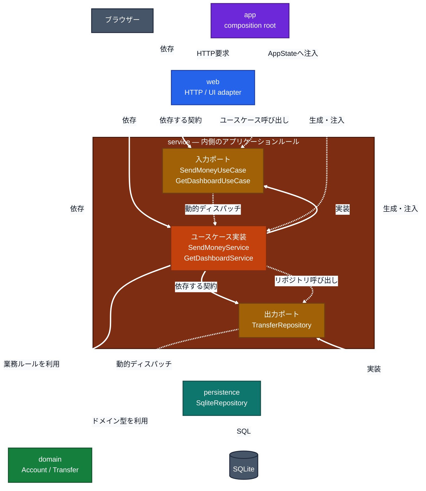

# アーキテクチャ

## クレートと依存方向

実線はソースコード上の依存またはtrait実装関係、点線は起動時の注入と実行時の呼び出しを示します。依存性逆転の要点は、外側の`persistence`が内側の`service`所有の`TransferRepository`を実装し、内側のserviceがSQLiteではなくこのポートに依存することです。`web`もserviceの入力ポートだけを呼び出し、具象ユースケースを知りません。

`app`は具体型を選び、`Arc<dyn TransferRepository>`とユースケースtrait objectを組み立てて注入します。実行時はユースケースからポートを呼びますが、ソースコード上の依存先は内側の抽象です。`domain`は他の自プロジェクトクレートに依存せず、serviceにもHTTP・SQLx・SQLiteの型を持ち込みません。

## ポートの具体例

送金とダッシュボード取得で、serviceはデータ保存を必要としますが、SQLiteの具体型には依存しません。[`TransferRepository`](../crates/service/src/ports/repository.rs) が必要な操作を定義し、`persistence`の`SqliteRepository`が実装します。永続化の詳細がservice所有の抽象に合わせます。

同様に、serviceは [`SendMoneyUseCase`](../crates/service/src/transfer/send_money.rs) と `GetDashboardUseCase` を入力ポートとして定義します。`web`はこれらのtraitを呼び出し、具象ユースケースを参照しません。serviceはSQLite・SQLx・HTTPを知りません。

実行時にはserviceが`TransferRepository`を呼びますが、実装の選択と注入は [`app/src/main.rs`](../app/src/main.rs) で行います。ここで`SqliteRepository`を`Arc<dyn TransferRepository>`としてユースケースへ渡し、`SendMoneyService`／`GetDashboardService`をWebへ渡します。ユースケーステストでは、この実装をfakeに差し替えられます。

## 境界と責務

- `service`は同一口座や送金上限などのユースケース上の検証を行います。送金先・送金元の残高ルールは`domain`のモデルで判断し、SQLite実装は書き込みロック中に残高を読み、検証・記録を同一トランザクションで行います。
- `persistence`はSQLxの失敗をログに記録して`TransferRepositoryError`へ変換します。serviceはそれをユースケースのエラーへ変換し、webは業務結果や抽象化された失敗をHTTP応答へ変換します。SQLite固有のエラー型は外側に留まります。
- `web`は`SendMoneyUseCase`／`GetDashboardUseCase`とserviceのDTOを使い、画面表示前にWeb所有のViewModelへ変換します。SQLx行型やSQLite接続型を扱いません。
- 設定の読込、DB接続・マイグレーション、依存の組み立ては`app`が担います。画面文言は`web`、DBスキーマは`migrations/`が所有します。

## テスト

ユースケースはfakeリポジトリでSQLiteなしにテストし、永続化はインメモリSQLiteと実マイグレーションで検証します。全テストは`cargo test --workspace`で実行します。
